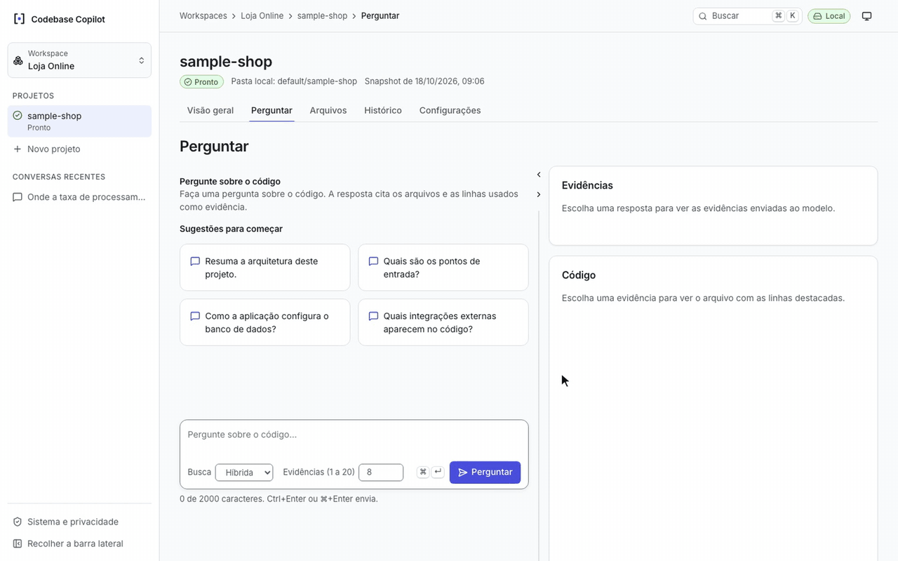
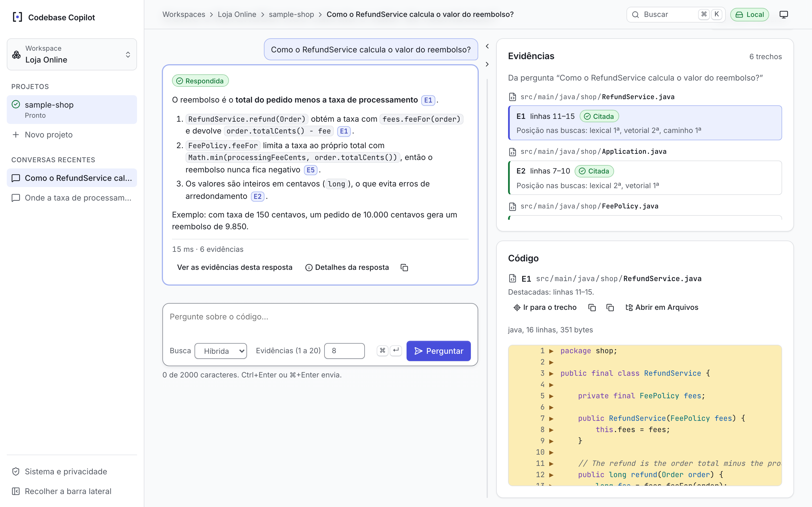
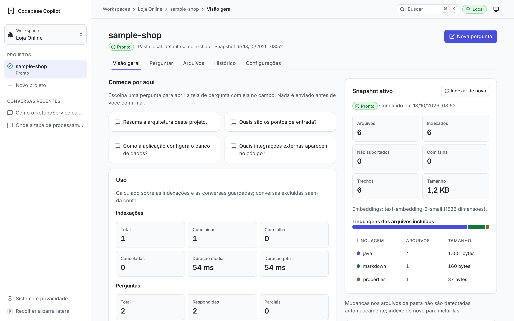
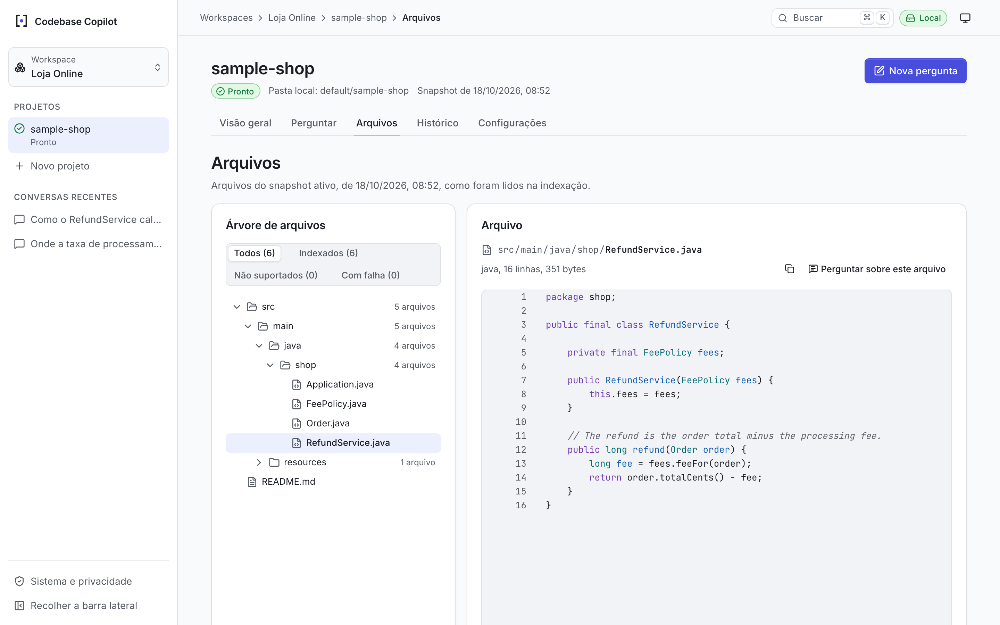
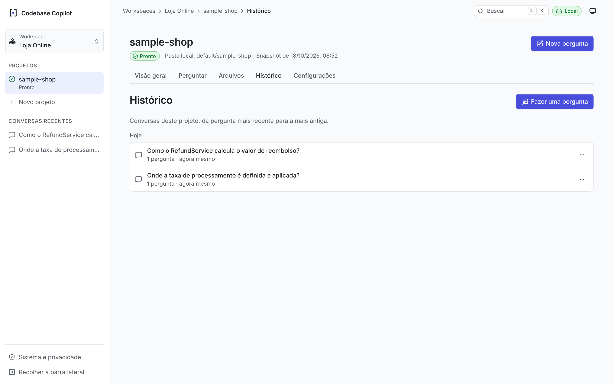
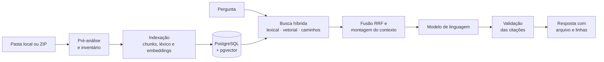

<div align="center">

# Codebase Copilot

**Pergunte qualquer coisa sobre um repositório e receba respostas com evidências: o arquivo e as linhas de onde cada afirmação saiu.**

Local-first · Busca híbrida (lexical + vetorial + caminhos) · Citações validadas · Nenhum código importado é executado


<picture>
  <source media="(prefers-color-scheme: dark)" srcset="docs/media/demo-dark.gif">
  
</picture>

</div>

## Por que existe

Entrar num projeto desconhecido significa descobrir onde estão as regras de negócio, como um fluxo atravessa as camadas e quais módulos fazem o quê. Perguntar a um modelo de linguagem sem contexto controlado produz respostas convincentes, mas sem como conferir.

O Codebase Copilot indexa o repositório na sua máquina, recupera os trechos relevantes para cada pergunta e só aceita uma resposta cujas citações apontem para trechos que o modelo de fato recebeu. Toda afirmação pode ser conferida no código com um clique, e quando não há evidência suficiente a ferramenta diz que não sabe.

## Recursos

- **Importação segura** de uma pasta local ou de um ZIP, com pré-análise antes de indexar: arquivos incluídos, linguagens, tamanho e o que foi excluído (dependências, artefatos gerados, `.env`, chaves e binários).
- **Indexação incremental por snapshots**, com hash de conteúdo, fila resiliente a quedas e cancelamento a qualquer momento.
- **Busca híbrida**: canal lexical com tokenizador de identificadores (`getUserById` → `get user by id`), canal vetorial com pgvector e canal de caminhos, combinados por Reciprocal Rank Fusion.
- **Respostas com citações verificáveis**: cada `[E1]`, `[E2]`… aponta para arquivo e linhas e é validada contra as evidências enviadas ao modelo. Citações inválidas são descartadas e sinalizadas.
- **Visualizador de código** com realce de sintaxe para mais de dez linguagens, linhas citadas destacadas e prévia da evidência ao passar o mouse.
- **Explorador de arquivos** do snapshot e "Perguntar sobre este arquivo".
- **Histórico de conversas** com perguntas de acompanhamento e as evidências preservadas mesmo após a reindexação.
- **Transparência de uso**: tokens, custo estimado, latência de cada etapa e a posição de cada trecho em cada canal da busca.
- **Interface pensada para o dia a dia**: paleta de comandos (⌘K), atalhos de teclado, tema claro e escuro, layout responsivo e conformidade com WCAG 2.2 AA.

## Telas

<table>
  <tr>
    <td width="50%">
      <picture>
        <source media="(prefers-color-scheme: dark)" srcset="docs/media/resposta-dark.png">
        
      </picture>
      <p align="center"><b>Resposta com evidências</b><br>Citações validadas, ranks da busca e o trecho no código.</p>
    </td>
    <td width="50%">
      <picture>
        <source media="(prefers-color-scheme: dark)" srcset="docs/media/visao-geral-dark.png">
        
      </picture>
      <p align="center"><b>Visão geral do projeto</b><br>Snapshot ativo, linguagens, indexações e perguntas.</p>
    </td>
  </tr>
  <tr>
    <td width="50%">
      <picture>
        <source media="(prefers-color-scheme: dark)" srcset="docs/media/arquivos-dark.png">
        
      </picture>
      <p align="center"><b>Arquivos</b><br>A árvore do snapshot exatamente como foi indexada.</p>
    </td>
    <td width="50%">
      <picture>
        <source media="(prefers-color-scheme: dark)" srcset="docs/media/historico-dark.png">
        
      </picture>
      <p align="center"><b>Histórico</b><br>Conversas guardadas para retomar e auditar.</p>
    </td>
  </tr>
</table>

## Como funciona



1. **Importar:** a aplicação lê apenas pastas dentro das raízes que você autoriza, ou extrai um ZIP com limites contra zip bombs e path traversal.
2. **Indexar:** os arquivos viram chunks com caminho e linhas, termos de identificador e vetores, guardados num snapshot imutável. Reindexar sem mudanças não reprocessa nada.
3. **Recuperar:** cada pergunta passa pelos três canais de busca, e os resultados são fundidos e encaixados num orçamento de tokens, com rótulos `E1`…`En`.
4. **Responder e validar:** o modelo responde num formato estruturado estrito, e cada citação é conferida contra as evidências e as linhas que ele recebeu antes de chegar à tela.

Os detalhes estão em [Pipeline RAG](docs/04-RAG-PIPELINE.md) e [Arquitetura](docs/02-ARCHITECTURE.md).

## Privacidade e segurança

- **Seu código fica na sua máquina.** Com os provedores desligados (`none`, o padrão), nada sai do computador. Com um provedor remoto, só vão os trechos selecionados como evidência e o texto das perguntas, nunca arquivos excluídos.
- **Nenhum código importado é executado**, em nenhuma etapa.
- **API restrita à própria máquina:** o backend escuta em `127.0.0.1`, recusa outros hosts e origens e envia Content Security Policy estrita.
- **Segredos protegidos:** chaves de API nunca aparecem em logs nem em mensagens de erro, e o conteúdo de código e os prompts não são registrados em log.

Mais em [Segurança, privacidade e custos](docs/07-SECURITY-PRIVACY-COSTS.md).

## Stack

| Camada | Tecnologias |
|---|---|
| Backend | Java 25, Spring Boot 4.1, Spring Data JDBC + JdbcClient, Flyway, monólito modular |
| Busca e dados | PostgreSQL 17, pgvector, `tsvector`, `pg_trgm` |
| IA | SDK oficial `openai-java`, encapsulado atrás de portas internas e substituível |
| Frontend | React 19, Vite, TypeScript, TanStack Query, Radix UI, Lezer (realce de sintaxe em Web Worker) |
| Qualidade | JUnit + Testcontainers, Vitest + Testing Library, Playwright com regressão visual e axe |
| Contrato | REST + OpenAPI, com tipos do frontend gerados do contrato |

## Início rápido

**Pré-requisitos:** JDK 25, Docker com Docker Compose e Node.js 22.22.2 ou mais novo. O Maven vem pelo wrapper `./mvnw`.

```bash
# 1. Configuração: defina a senha do banco, a pasta dos repositórios e os provedores
cp .env.example .env

# 2. Banco de dados (PostgreSQL 17 + pgvector)
docker compose -f infra/docker-compose.yml --env-file .env up -d

# 3. Build com a interface embutida e execução
cd apps/backend
./mvnw -Pwith-ui clean package -DskipTests
java -jar target/backend-0.0.1-SNAPSHOT.jar
```

Abra <http://localhost:8080>, crie um workspace, importe um projeto e faça a primeira pergunta.

### Principais variáveis do `.env`

| Variável | Uso |
|---|---|
| `DB_PASSWORD` | Senha do banco (troque o valor de exemplo). |
| `PROJECTS_ROOT` | Pasta sob a qual ficam os repositórios que podem ser importados. Sem ela, só a importação por ZIP fica disponível. |
| `EMBEDDING_PROVIDER` / `EMBEDDING_API_KEY` | Provedor de embeddings: `none` (padrão), `openai` ou `fake` (demonstração local). |
| `GENERATION_PROVIDER` / `GENERATION_API_KEY` | Provedor das respostas: `none` (padrão), `openai` ou `fake` (demonstração local). |

Todas as variáveis e propriedades, o modo de desenvolvimento com hot reload e a execução dos testes estão em [Configuração e desenvolvimento](docs/12-DEVELOPMENT.md).

## Qualidade

```bash
cd apps/backend && ./mvnw verify    # testes unitários e de integração, formatação e contrato OpenAPI
cd apps/web && npm run check        # tipos, lint, formatação, testes e build
cd apps/web && npm run e2e          # fluxo completo no browser, acessibilidade e regressão visual
```

A busca e as respostas também têm harnesses de avaliação próprios (Recall@k, MRR, validade das citações, abstenção e custo) sobre corpora versionados em [`eval/`](eval/README.md).

## Documentação

| Documento | Conteúdo |
|---|---|
| [Resumo executivo](docs/RESUMO-EXECUTIVO.md) | Visão, problema e proposta de valor |
| [PRD](docs/01-PRD.md) | Requisitos do produto |
| [Arquitetura](docs/02-ARCHITECTURE.md) | Módulos, fronteiras e decisões de design |
| [Pipeline RAG](docs/04-RAG-PIPELINE.md) | Indexação, busca híbrida, contexto e validação |
| [Modelo de dados](docs/05-DATA-MODEL.md) | Esquema do PostgreSQL |
| [Contratos da API](docs/06-API-CONTRACTS.md) | Endpoints, formatos e códigos de erro |
| [Segurança, privacidade e custos](docs/07-SECURITY-PRIVACY-COSTS.md) | O que sai da máquina, quando e quanto custa |
| [Avaliação](docs/08-EVALUATION.md) | Métricas e metodologia |
| [Decisões](docs/10-DECISIONS.md) | Registro das decisões técnicas |
| [Operação](docs/11-OPERATIONS.md) | Backup, recuperação de falhas e limites |
| [Configuração e desenvolvimento](docs/12-DEVELOPMENT.md) | Referência completa de configuração e testes |
